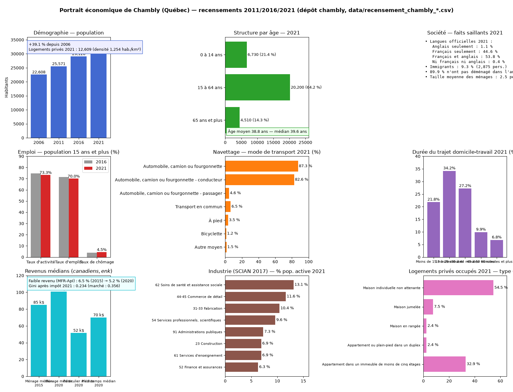
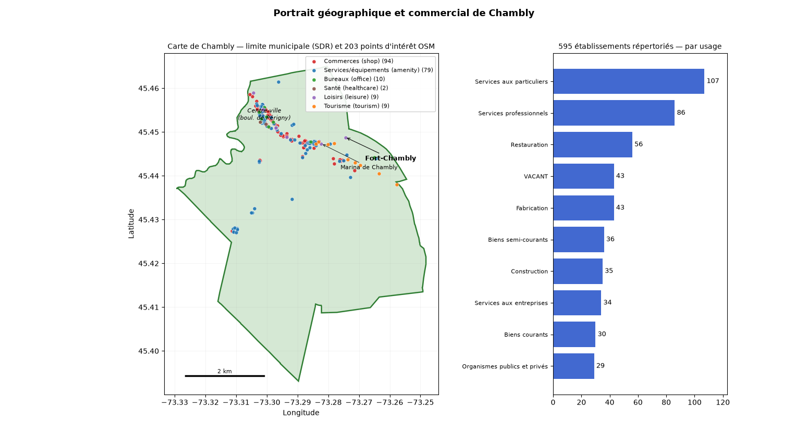

# Portrait économique et géographique de Chambly (Québec)

Analyse Python (matplotlib) réalisée à partir des données de ce dépôt :
`data/recensement_chambly_2011.csv`, `_2016.csv`, `_2021.csv`,
`data/SDR_chambly.gpkg`, `data/occupant_chambly_final.gpkg` (+ `commerces_chambly.gpkg` du dépôt OpenStreetMap).




## Faits saillants

- **Démographie** : population 22 608 (2006) → 31 444 (2021), soit +39.1 % en 15 ans.
  0-14 ans : 21.4 % | 15-64 ans : 64.2 % | 65+ : 14.3 % ; âge moyen 38.8 ans.
  12 609 logements privés en 2021 (densité 1,254 hab./km² sur 25.08 km²).
- **Emploi (2021)** : taux d'activité 73.3 %, taux d'emploi 70.0 %, chômage 4.5 %
  (2016 : 74.6 % / 71.6 % / 4.0 %).
  Navettage : automobile, camion ou fourgonnette 87.3 %.
- **Revenus** : ménage médian 85 039 $ (2015) → 101 000 $ (2020) ; particulier médian 2020 51 600 $ ;
  plein temps médian 70 000 $. Faible revenu (MFR-ApI) : 6.5 % → 5.2 %.
  Gini après impôt 2021 : 0.234 (marché 0.356).
- **Industrie 2021 (SCIAN, % pop. active)** : soins de santé et assistance sociale 13.1 %, commerce de détail 11.6 %, fabrication 10.4 %.
- **Société 2021** : 89.9 % sans déménagement dans l'année ; immigrants 9.3 % ; bilingues fr+en 53.8 %.
- **Carte** : 203 points OSM à Chambly (dont 94 commerces), 595 établissements répertoriés.

## Reproduction

```bash
pip install matplotlib pandas
python analyses/generer_portrait.py   # depuis la racine du dépôt
```
